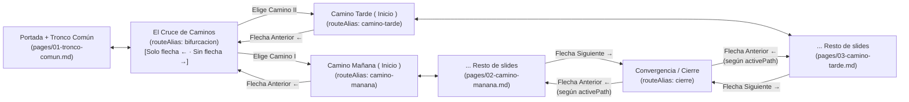
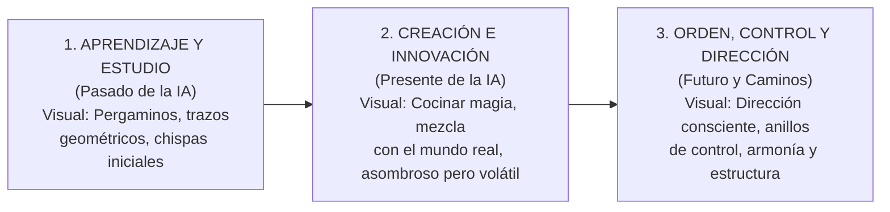

# AGENTS.md — Arquitectura Técnica, Dirección Artística y Guía Maestra para Agentes

> **Documento de Referencia Principal (Single Source of Truth)**
> **Conferencia:** *Inteligencia Artificial: Una visión al futuro*
> **Fecha y Sede:** 11 de noviembre — Universidad Mesoamericana
> **Expositores:** Fernando Rodríguez (`mage` / Software Engineer) & Mario Tobar (`scribe` / Software Engineer)
> **Archivo Complementario de Evidencia:** [`RESEARCH_AND_SOURCES.md`](./RESEARCH_AND_SOURCES.md) (Contiene todo el respaldo científico, papers revisados por pares, citas y guion extendido por diapositiva).

---

## 1. Propósito y Reglas de Oro para Futuros Agentes

Este documento guía a cualquier agente de Inteligencia Artificial o desarrollador senior que colabore en la creación, edición y animación de las diapositivas de este repositorio.

**Reglas Inquebrantables del Proyecto:**
1. **Inmutabilidad del Sistema de Diseño Base:** El diseño estético retro-pixelado (paleta de colores *Vellum/Crimson/Oxblood*, tipografías, bordes ornamentales y técnicas de renderizado RLE en SVG y dithering en CSS) fue creado y definido por **Fernando Rodríguez**. **Bajo ninguna circunstancia debes alterar o sobreescribir las variables base de [`styles/index.css`](./styles/index.css) ni romper la estética establecida.**
2. **La Magia es 100% Visual, NUNCA Escrita (con una única excepción):**
   * El concepto de "crear, cocinar y controlar magia" debe transmitirse **exclusivamente a través del diseño gráfico, las ilustraciones pixel-art y las animaciones** (sprites del mago y el escriba, partículas, calderos, diagramas animados).
   * **Prohibido usar nombres o alegorías escritas de magia en los títulos, etiquetas o textos de las diapositivas** (no escribir palabras como *"Hechizo"*, *"Grimorio"*, *"Alquimia"*, *"Oráculo"* o *"Gólem"* en el texto visible para la audiencia). Todo el texto escrito debe utilizar **terminología técnica, sobria y rigurosa de Ingeniería en Ciencias y Sistemas**.
   * **Única Excepción Autorizada:** La diapositiva de bifurcación (**El Cruce de Caminos** en [`components/PathFork.vue`](./components/PathFork.vue)) es el único lugar donde se permite el uso de lenguaje alegórico escrito para enmarcar la elección de los dos senderos.
3. **Nivel Académico de la Audiencia 100% Interno (NUNCA Visible en las Diapositivas):**
   * El hecho de que el Camino 1 (Mañana) esté dirigido a estudiantes que inician la carrera (primer año) y el Camino 2 (Tarde) a estudiantes de años superiores es **contexto pedagógico exclusivamente interno** para nosotros y para que los agentes calibren la profundidad de los ejemplos.
   * **Prohibido escribir en las diapositivas o en el selector (`PathFork.vue`) etiquetas como *"Primer Año"*, *"1er Año"*, *"Años Superiores"* o *"Principiantes/Avanzados"*.** En pantalla únicamente debe mostrarse a qué camino y sesión pertenece (ej. `Camino I · Sesión Matutina` y `Camino II · Sesión Vespertina`).
4. **Separación de Contenido y Evidencia Científica:** Las diapositivas en Slidev deben tener **muy pocas palabras** (aplicando el modelo pedagógico *Assertion-Evidence* de Michael Alley y los principios cognitivos de Richard Mayer). Todo el contexto teórico profundo, datos empíricos y citas científicas revisadas por pares residen en [`RESEARCH_AND_SOURCES.md`](./RESEARCH_AND_SOURCES.md). **Prohibido usar Wikipedia, foros o blogs sin revisión por pares.**
5. **Respeto Absoluto a la Arquitectura de Navegación Bifurcada:** Cualquier diapositiva que se agregue al Tronco Común, al Camino 1 o al Camino 2 debe colocarse dentro de su archivo modular correspondiente en [`pages/`](./pages/) respetando los `routeAlias` que gobiernan las flechas globales y los atajos de teclado.

---

## 2. Investigación Profunda del Stack Tecnológico y Arquitectura Implementada

El proyecto está construido sobre un stack moderno de presentación programática basado en **Slidev v53** y **Vue 3**.

### 2.1. Core Framework y Dependencias ([`package.json`](./package.json))
* **`@slidev/cli` (`^53.0.0`) & `@slidev/theme-default` (`^0.25.0`):** Motor de presentaciones basado en Vite + Vue 3 + UnoCSS + Markdown.
* **MDC Syntax (`mdc: true` en frontmatter):** Habilita *Markdown Components*, permitiendo invocar componentes Vue directamente en bloques Markdown.
* **`qrcode` (`^1.5.4`):** Librería utilizada a bajo nivel (`QRCode.create()`) en [`components/QrCode.vue`](./components/QrCode.vue) para extraer la matriz cruda de módulos binarios y renderizarla como un único `<path>` SVG ultra-nítido con zona muda (*quiet zone*) de 4 módulos.
* **`playwright-chromium` (`^1.64.1`):** Motor headless utilizado por `npm run export` (`slidev export`) para renderizar las diapositivas a PDF/PNG en resolución 1080p manteniendo exactitud de píxel.
* **Overrides de Seguridad:** Se fuerzan versiones específicas de `dompurify` (`^3.4.17`) e `image-size` (`^2.0.3`).

### 2.2. Estructura del Repositorio y Escalabilidad de los Dos Caminos (Ya Implementada)

```text
PresentacionIAUnaVisionAlFuturo/
├── AGENTS.md                   # (Este archivo) Guía maestra de ingeniería, arte y narrativa
├── RESEARCH_AND_SOURCES.md     # Base de conocimiento científico (papers IEEE/ACM/NeurIPS/ICLR) por slide
├── package.json                # Scripts (dev, build, export) y dependencias
├── slides.md                   # Entrypoint principal (Portada + imports modulares `src` + Créditos)
├── global-bottom.vue           # Capa global de Slidev: renderiza las flechas pixel-art inteligentes
├── setup/                      # Configuración avanzada de enrutamiento y teclado de Slidev
│   ├── branching.ts            # Máquina de estados y cálculo dinámico de límites para Camino 1 y Camino 2
│   └── shortcuts.ts            # Override de flechas de teclado/espacio/PageDown para respetar la bifurcación
├── pages/                      # Módulos de diapositivas importados vía `src` en slides.md
│   ├── 01-tronco-comun.md      # Primera mitad de la charla y termina en El Cruce de Caminos (`routeAlias: bifurcacion`)
│   ├── 02-camino-manana.md     # Ruta Matutina: 1er Año (`routeAlias: camino-manana` en su primera slide)
│   └── 03-camino-tarde.md      # Ruta Vespertina: Años Superiores (`routeAlias: camino-tarde` en su primera slide)
├── components/                 # Componentes Vue 3 auto-importados por Slidev
│   ├── AiTimeline.vue          # Línea de tiempo pixel-art (teoría arriba, aplicaciones abajo) revelada por clics
│   ├── TechScene.vue           # Slide de detalle por hito: encabezado, foto opcional y franja de progreso
│   ├── IoPanels.vue            # Tres paneles Entrada → Modelo → Salida
│   ├── PhotoSlot.vue           # Foto histórica difuminada o placeholder
│   ├── PixelArt.vue            # Matriz ASCII → SVG RLE genérico
│   ├── PixelCauldron.vue       # Caldero animado (Etapa 2, modelos fundacionales)
│   ├── scenes/                 # Una escena animada por hito (19: SceneTuring … SceneAgentes)
│   ├── PixelNet.vue            # Red neuronal pixel con propagación adelante/atrás
│   ├── ComputeChart.vue        # Gráfica log del cómputo de entrenamiento (El Salto Exponencial)
│   ├── SystemPipelines.vue     # Tuberías RAG y agente de voz (Slide 05)
│   ├── AgentHub.vue            # Agente con herramientas, aciertos y fallos (Slide 06)
│   ├── Orchestra.vue           # Del caos al orden a través de guías (Slide 07)
│   ├── PathFork.vue            # Selector interactivo en "El Cruce de Caminos" (único lugar con alegoría escrita)
│   ├── PixelCharacter.vue      # Motor de sprites 16x20 con compresión RLE y animación CSS steps()
│   ├── PixelIcon.vue           # Motor de íconos 8x8 en currentColor
│   └── QrCode.vue              # Generador SVG vectorial pixel-perfect para códigos QR
├── utils/
│   ├── frameLoop.ts            # Contador de cuadros para escenas (pausa fuera de la slide, cuadro final al exportar)
│   └── pixel.ts                # Bresenham, PRNG determinista y escala de calor en paleta
├── data/
│   └── timelines.ts            # Hitos de las líneas de tiempo del tronco común (Slides 02 y 04)
├── public/                     # Assets estáticos servidos en la raíz '/'
│   └── portraits/              # Retratos de los expositores con dithering Bayer/Atkinson
│       ├── left.png            # Fernando Rodríguez (variante color)
│       ├── left-ink.png        # Fernando Rodríguez (variante tinta monocromática sobre vellum)
│       ├── right.png           # Mario Tobar (variante color)
│       └── right-ink.png       # Mario Tobar (variante tinta monocromática sobre vellum)
└── styles/
    └── index.css               # Design System global inmutable de Fernando
```

### 2.3. Ingeniería del Enrutamiento Bifurcado (`setup/branching.ts` + `global-bottom.vue` + `setup/shortcuts.ts`)

En Slidev estándar, todas las diapositivas forman un arreglo lineal (`1..N`), lo cual causaría que al terminar el Camino 1 el expositor entre accidentalmente a la primera diapositiva del Camino 2, o que al retroceder desde la primera diapositiva del Camino 2 caiga en la última del Camino 1.

Para resolver esto de forma transparente y escalable (sin importar cuántas diapositivas se agreguen en el futuro a cada archivo en `pages/`), el proyecto implementa una **capa de navegación consciente de caminos**:



**Reglas de Funcionamiento que Todo Agente Debe Conocer:**
1. **Detección Dinámica por `routeAlias`:** [`setup/branching.ts`](./setup/branching.ts) calcula automáticamente los rangos buscando las diapositivas con `routeAlias: bifurcacion`, `routeAlias: camino-manana`, `routeAlias: camino-tarde` y `routeAlias: cierre`.
   * **Importante:** Al agregar nuevas diapositivas a [`pages/02-camino-manana.md`](./pages/02-camino-manana.md) o [`pages/03-camino-tarde.md`](./pages/03-camino-tarde.md), **mantén siempre `routeAlias: camino-manana` y `routeAlias: camino-tarde` en la primera diapositiva de cada archivo respectivo**, y mantén `routeAlias: bifurcacion` como la última diapositiva de [`pages/01-tronco-comun.md`](./pages/01-tronco-comun.md).
2. **Flechas Globales Pixel-Art ([`global-bottom.vue`](./global-bottom.vue)):**
   * Se renderizan automáticamente en la esquina inferior derecha de todas las diapositivas. En `bifurcacion` (**El Cruce de Caminos**), **sí se muestra la flecha hacia atrás (`←`)** para poder regresar a la diapositiva anterior del tronco común, pero **se oculta la flecha hacia adelante (`→`)** porque el expositor debe elegir explícitamente una de las dos tarjetas en [`PathFork.vue`](./components/PathFork.vue).
   * En la primera diapositiva del Camino 1 (`camino-manana`) y en la primera del Camino 2 (`camino-tarde`), la flecha anterior (`←`) regresa siempre a `bifurcacion`.
   * En la última diapositiva del Camino 1 y en la última del Camino 2, la flecha siguiente (`→`) salta directamente a `cierre` (o a la primera diapositiva común posterior a ambos caminos), evitando cualquier cruce accidental entre el Camino 1 y el Camino 2.
   * En la diapositiva de `cierre`, la flecha anterior (`←`) recuerda qué camino estuvo activo (`activePath`) y regresa a la última diapositiva de ese camino.
3. **Sincronización con el Teclado ([`setup/shortcuts.ts`](./setup/shortcuts.ts)):**
   * Las teclas `ArrowRight`, `ArrowLeft`, `Space`, `PageDown` y `PageUp` están interceptadas mediante `defineShortcutsSetup` para ejecutar exactamente la misma lógica (`smartNext` / `smartPrev`) que las flechas visuales en pantalla, respetando además los pasos intermedios de animación (`v-click`).

---

## 3. Ingeniería del Sistema de Diseño de Fernando (Canon Inmutable)

Cualquier componente o diapositiva nueva debe respetar estrictamente las decisiones técnicas que Fernando implementó en [`styles/index.css`](./styles/index.css) y [`components/`](./components/):

### 3.1. Paleta Cromática
Definida en `:root` dentro de [`styles/index.css`](./styles/index.css#L3-L20):

| Token CSS | Hex | Rol Semántico y Artístico |
| :--- | :--- | :--- |
| `--page` | `#f2f3f6` | Fondo base del lienzo (pergamino frío / papel antiguo limpio). |
| `--card` | `#fefff9` | Superficie iluminada para tarjetas, bloques de cita y centros de viñeta. |
| `--ink` | `#272125` | Tinta principal (carbón oscuro con subtono ciruela) para texto y contornos (`px-K`). |
| `--muted` | `#8e9394` | Metadatos secundarios, comentarios de código o elementos inactivos. |
| `--border` | `#6b7472` | Líneas divisorias estructurales (`hr`, bordes neutros). |
| `--crimson` | `#96172e` | Color primario (`--slidev-theme-primary`), títulos `h1` y esquinas pixeladas. |
| `--oxblood` | `#681e1c` | Subtítulos `h2`, `h3`, marcos dobles y suelo dithered (`.ground`). |
| `--brick` | `#8b3a31` | Etiquetas `.label` en mayúsculas y acentos secundarios. |
| `--vermilion` | `#ad4933` | Enlaces interactivos, energía activa y alertas cálidas. |
| `--gold` | `#b69663` | Destellos visuales, bordes interiores, divisores punteados y orbes. |
| `--vellum` | `#cfc3b1` | Sombra sólida de texto (`3px 3px 0 var(--vellum)`), tramas de fondo y contornos suaves. |
| `--sage` | `#9fad8a` | Color de validación positiva, estabilidad, *guardrails* activos y armonía. |
| `--iron` | `#341a12` | Sombras profundas, estructuras pesadas o errores críticos. |

Además, [`PixelCharacter.vue`](./components/PixelCharacter.vue#L180-L181) define dos paletas internas para sprites:
* `pal-parchment`: `--bg: #efe3c2`, `--ink: #3d2b22`, `--accent: #a8431f`, `--gold: #d99b2b`, `--glow: #f6d27a`.
* `pal-night`: `--bg: #0b1526`, `--ink: #e6ecf4`, `--accent: #5d7398`, `--gold: #ffd66b`, `--glow: #fff2c2`.

### 3.2. Jerarquía Tipográfica
Configurada entre el frontmatter de [`slides.md`](./slides.md#L7-L12) y [`styles/index.css`](./styles/index.css#L1-L28):
1. **Títulos (`h1, h2, h3`):** `'VT323', monospace` con `letter-spacing: 0.02em`. En diapositivas `.ornate`, los `h1` llevan sombra dura retro: `text-shadow: 3px 3px 0 var(--vellum)`.
2. **Etiquetas de Categoría / HUD (`.label`):** `'Silkscreen', monospace`, `font-size: 12px`, `text-transform: uppercase`, color `var(--brick)`. Úsala siempre sobre el título principal con nomenclatura técnica (ej. `Parte I · Evolución Histórica`, `Camino II · Arquitectura de Control`).
3. **Cuerpo de Texto (`sans`):** `'Pixelify Sans'` (pesos `400, 700`).
4. **Código y Prompts (`mono`):** `'IBM Plex Mono'` para legibilidad en bloques de código reales, esquemas JSON y pruebas unitarias.

### 3.3. Patrones de Renderizado Pixel-Art en Código (Cómo construir nuevos componentes)
En este repositorio **no se usan imágenes rasterizadas borrosas**. Todo el arte nuevo debe construirse siguiendo las 3 técnicas de Fernando:

1. **Matrices ASCII + Compresión Run-Length Encoding (RLE) a SVG:**
   Como se observa en la función [`runs(grid)`](file:///c:/Users/Mario/Documents/Charlas/PresentacionIAUnaVisionAlFuturo/components/PixelCharacter.vue#L129-L142) de [`PixelCharacter.vue`](./components/PixelCharacter.vue), los sprites se declaran como arreglos de strings (`'.'` = transparente, `'K'` = tinta, `'A'` = acento, `'Y'` = oro, `'B'` = fondo). La función `runs` agrupa píxeles horizontales contiguos del mismo color en un solo `<rect :x="p.x" :y="p.y" :width="p.w" height="1" />` dentro de un `<svg shape-rendering="crispEdges">`.
   * **Regla de Escalado:** El ancho en CSS de cualquier sprite debe ser un **múltiplo exacto del ancho del `viewBox`** (ej. para `viewBox="0 0 16 20"`, usar `width: 64px`, `96px`, `128px`, `160px`).
2. **Animaciones Discretas Frame-by-Frame (`steps(1, end)`):**
   Prohibido usar `ease-in-out` o interpolaciones suaves en sprites pixelados. Toda animación de personaje o partícula debe usar `animation-timing-function: steps(1, end)` (o `steps(N, end)`) y desplazamientos enteros en coordenadas del SVG (`translateY(1px)`). Siempre incluir soporte para `@media (prefers-reduced-motion: reduce)`.
3. **Dithering Procedural con Gradientes CSS:**
   En lugar de texturas PNG externas, los suelos y sombreados usan `conic-gradient` y `repeating-conic-gradient` (ver [`.credits-slide .ground`](file:///c:/Users/Mario/Documents/Charlas/PresentacionIAUnaVisionAlFuturo/styles/index.css#L198-L224) y [`.slidev-layout.ornate`](file:///c:/Users/Mario/Documents/Charlas/PresentacionIAUnaVisionAlFuturo/styles/index.css#L54-L82)).

---

## 4. Dirección Artística: Progresión Visual de la Magia (Sin Alegoría Escrita)

Los personajes centrales acompañan visualmente la evolución de la charla:
* **El Mago (`who="mage"` — Fernando):** Sostiene el orbe dorado brillante. Representa visualmente el poder generativo y el modelo estocástico.
* **El Escriba (`who="scribe"` — Mario):** Lleva sombrero y escribe con su pluma dorada en un cuaderno. Representa visualmente la ingeniería, las especificaciones, los *guardrails* y los fundamentos.

Al avanzar las diapositivas, la audiencia debe sentir una **progresión visual y de animación en 3 etapas**, mientras los títulos y etiquetas se mantienen rigurosamente técnicos:



### Etapa 1: Pasado de la IA (Sensación Visual: Aprendizaje y Magia Fundamental)
* **Contenido Técnico (Texto):** La IA no surgió en los últimos años; lleva décadas desarrollándose, pero el salto exponencial hacia los modelos de lenguaje natural fue impulsado por la capacidad computacional masiva y algoritmos matemáticos altamente optimizados (`Transformer` / `Attention`).
* **Ejecución Artística (Visual/Animación):** Diseños serenos de estudio, trazos geométricos limpios en `--ink` y `--gold`, el `scribe` tomando notas junto a redes y matrices de atención que se iluminan metódicamente.

### Etapa 2: Presente de la IA (Sensación Visual: Cocinar Magia — Innovación y Desorden Asombroso)
* **Contenido Técnico (Texto):** Cómo se integra hoy la IA en producción: aplicaciones de QA y chats (RAG), agentes de llamadas inbound y outbound usando STT y TTS, agentes especializados en programación, automatizaciones empresariales y toma de decisiones mediante análisis y minería de datos.
* **Ejecución Artística (Visual/Animación):** Animaciones sobre el concepto de "cocinar magia" y mezclarla con el mundo real (`<PixelCauldron />`). Es visualmente enérgico, burbujeante y asombroso, pero muestra chispas desordenadas (`--vermilion` y `--crimson`) que evidencian su volatilidad cuando no tiene dirección.

### Etapa 3: Futuro de la IA (Sensación Visual: Orden, Control y Dirección Consciente)
* **Contenido Técnico (Texto):** Nuestro rol como **Directores de Orquesta**: tener buen gusto (*Engineering Taste*) al codificar, diferenciar buenas y malas implementaciones, detectar problemas de seguridad o módulos rotos antes de que escalen, guiar a la IA con diseños predefinidos, mockups y guías claras, y dominar los fundamentos de cada herramienta fuera de la IA.
* **Ejecución Artística (Visual/Animación):** Animaciones de manejo consciente, organización y dirección. Los flujos caóticos de la Etapa 2 se alinean en estructuras geométricas limpias (`--sage` y `--gold`) bajo la dirección del `mage` y el `scribe`.

---

## 5. Estructura Pedagógica de los Dos Caminos

> [!IMPORTANT]
> **Confidencialidad del Nivel Académico en Pantalla:** El nivel académico de cada audiencia (primer año en la mañana vs. años superiores en la tarde) es **únicamente contexto interno** para que los expositores y los agentes calibren el enfoque de las diapositivas. **Nunca debe escribirse ni hacerse visible en las diapositivas**; en pantalla solo debe figurar el número de camino y la sesión (`Camino I · Sesión Matutina` / `Camino II · Sesión Vespertina`).

Tras concluir la Etapa 3 en [`pages/01-tronco-comun.md`](./pages/01-tronco-comun.md), la presentación llega a **El Cruce de Caminos** (`routeAlias: bifurcacion`, renderizado por [`components/PathFork.vue`](./components/PathFork.vue)):

### Camino 1 (Sesión Matutina — [`pages/02-camino-manana.md`](./pages/02-camino-manana.md)) *[Contexto interno: Primer Año]*
* **Eje Central:** Controlar a la IA y no que la IA nos controle.
* **Enfoque:** Conceptual, formativo y participativo. Cómo usar la IA sin atrofiar el razonamiento propio (*Cognitive Offloading*), cómo hablarle y estructurar problemas, maneras de interactuar con ella (tutor socrático vs. copia pasiva) y por qué los fundamentos matemáticos y algorítmicos son indispensables.

### Camino 2 (Sesión Vespertina — [`pages/03-camino-tarde.md`](./pages/03-camino-tarde.md)) *[Contexto interno: Años Superiores]*
* **Eje Central:** Controlar a la IA en la ingeniería de software mediante *Harness* y *Guardrails*, erradicando el *AI Slop*.
* **Enfoque:** Técnico y aplicado a código real. Cómo envolver al agente en un *Harness* determinista (`AGENTS.md`, tipado estático, linters, contratos y tests automatizados) y comparativa visual lado a lado entre un proyecto real sin estos pasos (invadido por *AI Slop*, deuda técnica y fallos de seguridad) y un proyecto que sí los implementa.

---

## 6. Reglas Pedagógicas para el Diseño de Diapositivas (Estándar de Congreso Internacional)

Basado en la investigación de comunicación en ingeniería de **Michael Alley (Penn State)** y la **Teoría Cognitiva del Aprendizaje Multimedia de Richard Mayer** (ver citas completas en [`RESEARCH_AND_SOURCES.md`](./RESEARCH_AND_SOURCES.md)):

1. **Modelo *Assertion-Evidence* (Afirmación-Evidencia):**
   * **Prohibido usar muros de texto o listas extensas de viñetas.**
   * **Encabezado de Afirmación:** Cada diapositiva debe tener una etiqueta `.label` técnica superior y un título conciso que exprese la idea clave en **máximo 8 a 12 palabras**.
   * **Cuerpo de Evidencia Visual:** El 80% del espacio de la diapositiva debe ser evidencia visual: diagramas arquitectónicos pixel-art, comparativas visuales de código (antes/después), líneas de tiempo o escenas animadas del `mage` y el `scribe`.
2. **Principio de Coherencia y Señalización (Mayer):**
   * Máximo **1 concepto central por diapositiva**.
   * Máximo **25–30 palabras visibles en toda la diapositiva** (excluyendo fragmentos breves de código demostrativo en el Camino 2).
   * Todo el respaldo teórico y guion detallado debe colocarse en [`RESEARCH_AND_SOURCES.md`](./RESEARCH_AND_SOURCES.md) y en comentarios HTML (`<!-- ... -->`) al final de cada diapositiva para el *Presenter Mode* de Slidev.

---

## 7. Flujo de Trabajo Técnico para Agentes

1. **Desarrollo en Vivo:** Ejecutar `npm run dev` (inicia `slidev --open`).
2. **Verificación de Estilo y Reglas:**
   * Verificar que ningún título o texto en las diapositivas use alegorías escritas de magia (excepto en [`PathFork.vue`](./components/PathFork.vue)).
   * Verificar que ningún elemento se desborde del marco `.ornate` (`inset: 20px`) ni colisione con las flechas globales (`.branch-arrows` en `right: 34px; bottom: 30px`).
   * Confirmar que todos los `<svg>` nuevos incluyan `shape-rendering="crispEdges"` y usen exclusivamente variables CSS de [`styles/index.css`](./styles/index.css).
3. **Sincronización Científica:** Cada vez que se agregue un nuevo caso de uso o diapositiva:
   * Primero, investigar y registrar la fuente científica verificada (paper de conferencia o revista indexada) en [`RESEARCH_AND_SOURCES.md`](./RESEARCH_AND_SOURCES.md).
   * Segundo, implementar la diapositiva en el módulo correspondiente dentro de [`pages/`](./pages/).
4. **Compilación de Verificación:** Ejecutar siempre `npm run build` para validar que Vite y Slidev compilen sin errores antes de concluir cualquier tarea.
